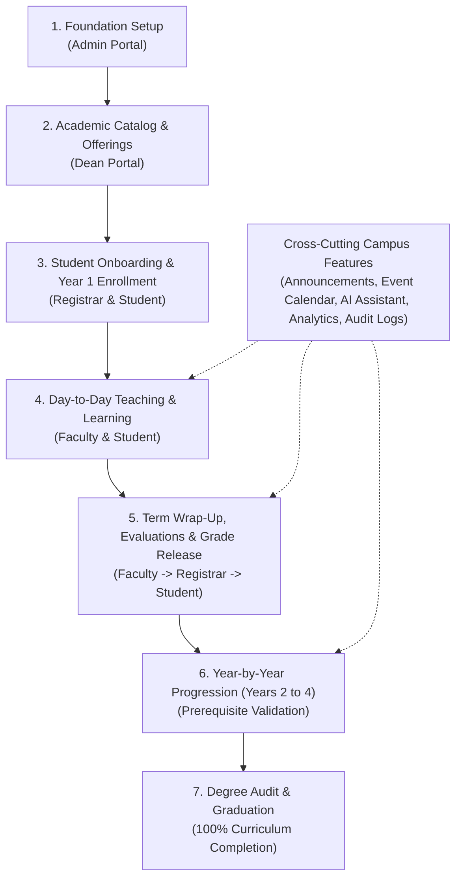

# AU-JAS LMS: End-to-End Workflow Guide

> **Reading Time:** ~5 minutes  
> **Audience:** Anyone — school administrators, faculty, students, and stakeholders without a technical or computer science background.

---

## 1. Quick Glossary: Plain-English Terminology

Before exploring the workflows, here is a quick reference for the foundational terms used across the system:

* **School Year & Term:** The academic calendar (e.g., *Academic Year 2025–2026*), divided into operational terms such as *1st Semester*, *2nd Semester*, or *Summer Term*.
* **Program:** A degree or academic track (e.g., *Bachelor of Science in Computer Science*).
* **Course vs. Section:**
  * **Course:** The official academic blueprint or syllabus (e.g., *CS101 – Introduction to Computing*, 3 units).
  * **Section:** An actual scheduled class offering with an assigned instructor, meeting time, room, and enrolled students (e.g., *Section SEC-7174, MWF 9:00 AM – 10:00 AM, Room 302*).
* **Curriculum Map:** The degree roadmap. A structured checklist defining all courses required year-by-year and term-by-term for degree completion.
* **Prerequisite:** A required prerequisite subject. You must pass a foundational course (e.g., *Programming 1*) before the system permits enrollment in the advanced course (e.g., *Programming 2*).
* **Units / Credits:** The academic weight assigned to a course, reflecting weekly lecture or laboratory hours.
* **Grading Periods & Transmutation:**
  * **Grading Periods:** Assessment milestones within a term (such as *Prelims*, *Midterms*, and *Finals*).
  * **Transmutation:** The official scale used to convert raw scores and percentages (e.g., 94%) into institutional grade equivalents (e.g., 1.25 or A).
* **GWA (General Weighted Average):** The student's overall academic average, calculated by weighting course grades against their unit values.
* **Academic Thresholds:** Rules determining academic honors (such as *Dean’s List* or *President’s List*) or identifying students who require academic assistance (*Academic Probation*).

---

## 2. System Architecture & End-to-End Lifecycle



---

## 3. The Complete Step-by-Step Flow

### Phase 1: Setting the Foundation (The System Administrator)
*Establishing the organizational structure, user access, and institutional academic rules.*

1. **Departments & User Roles:**
   * The Administrator registers academic departments (e.g., *College of Computer Studies*, *College of Business*).
   * Assigns user permissions across five dedicated roles: **Admin**, **Dean**, **Registrar**, **Faculty**, and **Student**.
2. **User Onboarding & Invitations:**
   * New faculty, staff, and students receive account setup invitations. Upon opening their activation link, users securely create their password.
3. **The Academic Calendar Wizard:**
   * The Admin launches the comprehensive school year wizard to configure:
     * Start and end dates for the School Year and its Terms.
     * Enrollment open and close windows.
     * Grading periods (*Prelim*, *Midterm*, *Finals*) and grade encoding deadlines.
     * Grading components, weights, and the institutional transmutation table.
     * Institutional holidays and calendar exception dates.
     * Academic honors and probation thresholds.
4. **Faculty Evaluation Templates:**
   * The Admin defines standard end-of-term evaluation instruments (Likert rating matrices and qualitative feedback prompts).

---

### Phase 2: Building the Academic Catalog & Offerings (The Academic Dean)
*Structuring degree curricula, scheduling classes, and assigning teaching personnel.*

1. **Degree Programs & Course Blueprints:**
   * The Dean enters degree programs and individual course blueprints, specifying lecture units, laboratory units, and course classifications.
2. **Curriculum Mapping:**
   * Courses are arranged across Year Levels (1st Year to 4th Year) and Terms, linking required prerequisites to ensure proper academic sequencing.
3. **Opening Class Sections:**
   * The Dean creates active class sections for the term, establishing enrollment limits, weekly meeting schedules, and room allocations.
4. **Faculty Loading & Conflict Verification:**
   * Instructors are assigned to class sections. The system automatically verifies workload unit maximums and detects any room, instructor, or student time conflicts.

---

### Phase 3: Student Onboarding & Year 1 Enrollment (Registrar & Student)
*Welcoming incoming students, verifying academic records, and issuing class schedules.*

1. **Profile & Program Verification:**
   * The student logs into the Student Portal to review personal details and select their degree program (e.g., *BS Computer Science*).
   * The Registrar reviews and approves the submission in the **Student Verification** workspace.
2. **First-Year Enrollment:**
   * The Registrar enrolls the 1st-year student into active block sections corresponding to their 1st-year curriculum.
   * Enrollment can be conducted individually or through automated bulk CSV imports.
3. **Class Schedule Issuance:**
   * The student's dashboard and schedule views instantly populate with their weekly timetable, assigned faculty, and room locations.

---

### Phase 4: Day-to-Day Teaching & Learning (Faculty & Student)
*The active semester routine inside physical and virtual classrooms.*

1. **Subject Workspaces:**
   * Each section has a dedicated workspace housing instructional content, syllabi, announcements, and class rosters.
2. **Attendance Management:**
   * Instructors log attendance per session using standardized statuses: **Present**, **Late**, **Excused**, or **Absent**. Students monitor their overall attendance rate in real time.
3. **Assessments & Submissions:**
   * Faculty create quizzes, problem sets, and examinations using multiple question types (Multiple Choice, Identification, Essay, and File Uploads).
   * Students complete timed assessments or upload project files.
   * Faculty review submissions, apply grading rubrics, record scores, and provide written feedback.

---

### Phase 5: Term Wrap-Up, Grade Release & Evaluations
*Final examinations, faculty feedback, and official grade publishing.*

1. **Faculty Evaluations:**
   * Prior to term completion, enrolled students complete anonymous evaluations for each of their instructors.
   * Faculty receive aggregated survey analytics to support teaching development.
2. **Grade Computation & Submission:**
   * Faculty review component weights (quizzes, projects, exams, attendance), verify transmuted periodic grades, and submit final section grade sheets to the Registrar.
3. **Registrar Review & Grade Release:**
   * The Registrar audits submitted grade sheets for institutional compliance and officially releases grades.
4. **Student Grade Breakdown:**
   * Students access their term grade reports, showing periodic grades, final remarks, and granular scoring breakdowns.

---

### Phase 6: Year-by-Year Progression to Graduation (Years 2, 3, & 4)
*Advancing through the curriculum until all degree requirements are fulfilled.*

```
Year 1 (Freshman)  ──>  Year 2 (Sophomore)  ──>  Year 3 (Junior)  ──>  Year 4 (Senior)  ──>  GRADUATION
Passing foundational   Unlocks intermediate    Unlocks advanced       Completes capstone &   100% curriculum
prerequisites          courses                 practicum/internship   thesis requirements    cleared!
```

1. **Automated Prerequisite Validation:**
   * When a student passes prerequisite courses, the enrollment engine unlocks subsequent intermediate and advanced subjects for enrollment.
2. **Handling Course Retakes:**
   * If a student fails a course, dependent subjects remain locked. However, previously completed subjects are preserved, and the student can retake the needed course during future offerings.
3. **Academic Standing & Honor Calculation:**
   * At the close of each term, the system recalculates the student's cumulative GWA, checking performance against Dean's List benchmarks or academic support criteria.
4. **Live Curriculum Audit:**
   * Students, Deans, and Registrars can inspect the **Curriculum Checklist** at any point:
     * **Units Earned vs. Required Units** (e.g., *142 / 142 Units*).
     * **Degree Progress Bar** (from 0% to 100%).
     * **Course Status Badges:** *Completed* (Green), *In Progress* (Amber), or *Not Taken* (Blue).
5. **Graduation Clearance:**
   * Once 100% of required curriculum courses and units are marked *Completed*, the student qualifies for graduation clearance and degree conferral.

---

## 4. Cross-Cutting Campus Features (Add-Ons)

These integrated tools enhance communication and administration without disrupting core workflows:

| Feature | Primary Users | Purpose |
| :--- | :--- | :--- |
| **Targeted Announcements** | Admins, Deans, Registrar, Faculty | High-visibility notifications with rich text and attachments. Can be targeted institution-wide, by department, by user role, or to a specific class section. |
| **Campus Event Calendar** | Entire Institution | Centralized calendar tracking holidays, examination weeks, enrollment windows, and academic deadlines. |
| **In-App Notifications** | Entire Institution | Instant notifications for grade releases, newly posted assessments, submission feedback, and verification updates. |
| **AI Academic Assistant** | Students & Faculty | Intelligent assistant powered by Gemini to help students clarify course concepts and help instructors organize coursework. |
| **Academic Insights** | Students, Deans, Leadership | Analytical dashboards showing GWA trends, grade distributions, and student retention metrics. |
| **Audit & Registrar Logs** | Admins & Registrars | Immutable audit trails recording user access, grade changes, enrollment updates, and profile verifications with before-and-after change diffs. |

---

## 5. Summary Matrix by Academic Milestone

| Stage | Milestone | Primary Roles | Key Outcomes |
| :---: | :--- | :--- | :--- |
| **1** | **Foundation Setup** | Admin | School year configured, terms defined, grading rules & accounts established. |
| **2** | **Catalog & Offerings** | Dean | Programs created, curriculum mapped, sections scheduled, faculty assigned. |
| **3** | **Student Onboarding** | Registrar & Student | Profile verified, program assigned, Year 1 block enrollment completed. |
| **4** | **Term Instruction** | Faculty & Student | Class materials shared, daily attendance taken, assessments administered & graded. |
| **5** | **Term Closure** | Faculty, Registrar, Student | Anonymous faculty evaluations, grades submitted, approved, and released. |
| **6** | **Progression** | System & Registrar | Prerequisites checked, GWA updated, next-term enrollment unlocked. |
| **7** | **Graduation** | Dean, Registrar, Student | 100% units & curriculum audit cleared; degree conferred. |
