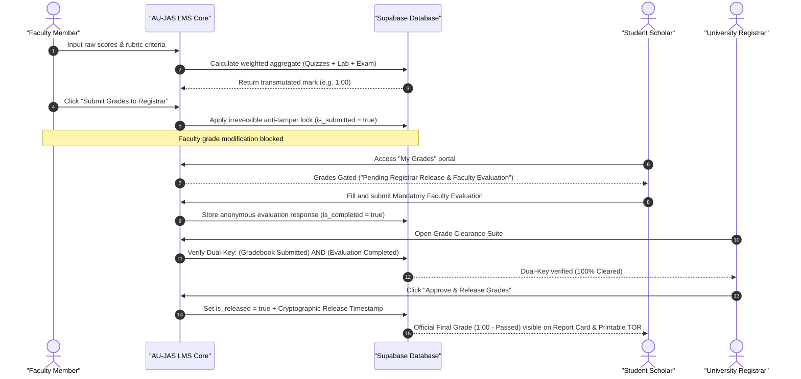
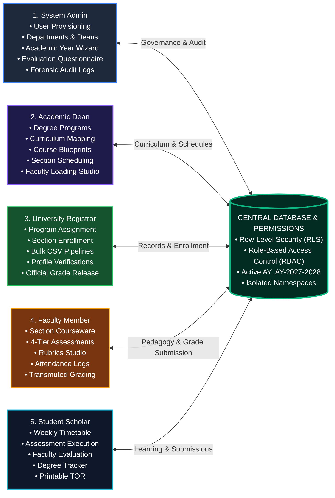
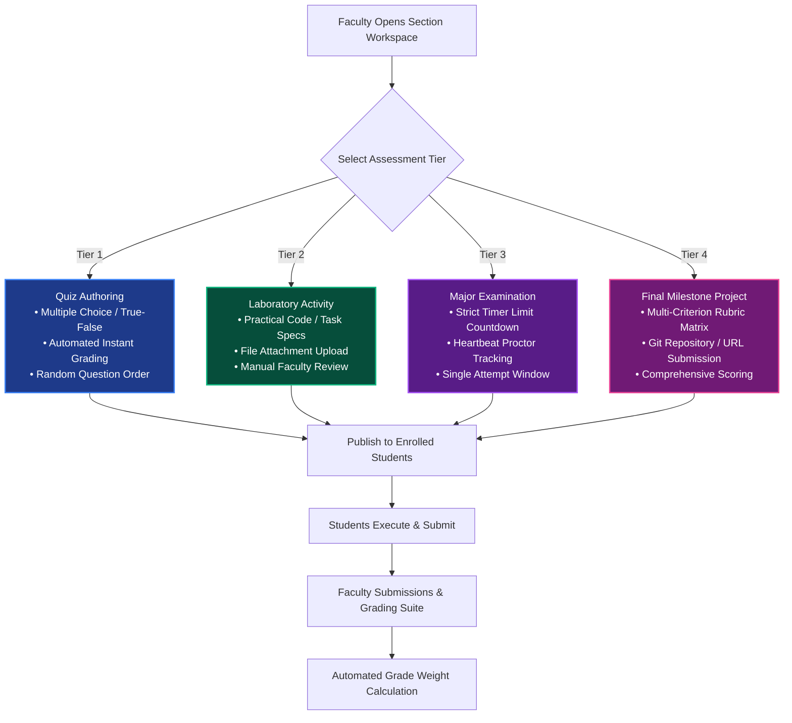
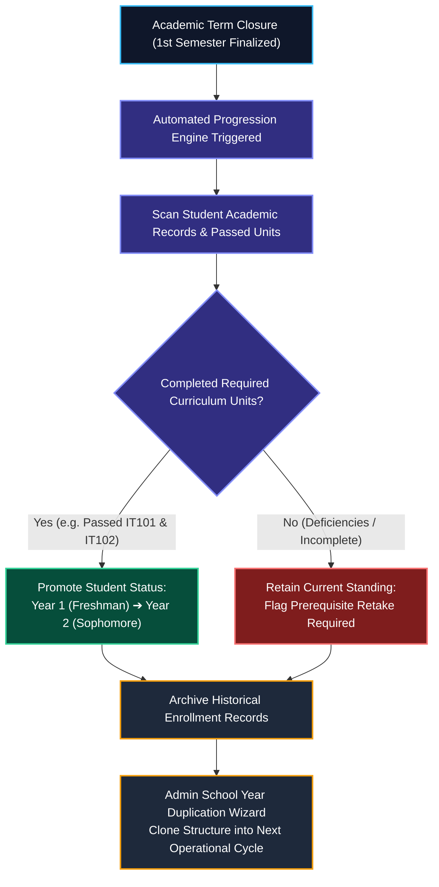

# 🏛️ AU-JAS LMS: Complete System Architecture & Operational Flowcharts
**Project:** An Upgraded AU-JAS LMS with Integrated AI Chatbot  
**Institution:** Arellano University – JAS Campus  
**Deployment URL:** `https://project-application-two.vercel.app`  

---

## 📑 Flowchart Directory
1. [Master End-to-End Academic Lifecycle Flowchart](#1-master-end-to-end-academic-lifecycle-flowchart)
2. [Dual-Key Grade Release & Anti-Tamper Security Architecture](#2-dual-key-grade-release--anti-tamper-security-architecture)
3. [Multi-Role Governance & Data Scoping Flowchart](#3-multi-role-governance--data-scoping-flowchart)
4. [Courseware, Rubrics & 4-Tier Assessment Authoring Lifecycle](#4-courseware-rubrics--4-tier-assessment-authoring-lifecycle)
5. [Automated Student Year-Level Promotion & Term Rollover Engine](#5-automated-student-year-level-promotion--term-rollover-engine)

---

## 1. Master End-to-End Academic Lifecycle Flowchart

This flowchart outlines the chronological, multi-role lifecycle of the institution—from institutional onboarding and curriculum blueprinting to student enrollment, instruction, grading, clearance, and annual academic promotion.

```mermaid
flowchart TD
    %% Roles Styling
    classDef adminStyle fill:#1e293b,stroke:#3b82f6,stroke-width:2px,color:#ffffff
    classDef deanStyle fill:#1e1b4b,stroke:#8b5cf6,stroke-width:2px,color:#ffffff
    classDef regStyle fill:#14532d,stroke:#22c55e,stroke-width:2px,color:#ffffff
    classDef facStyle fill:#78350f,stroke:#f59e0b,stroke-width:2px,color:#ffffff
    classDef studStyle fill:#0f172a,stroke:#06b6d4,stroke-width:2px,color:#ffffff
    classDef sysStyle fill:#312e81,stroke:#6366f1,stroke-width:2px,color:#ffffff

    %% ACT I: ADMIN GOVERNANCE
    subgraph S1["ACT I: System Administrator — Governance & Setup"]
        A1["1. Admin Logs In"]:::adminStyle --> A2["2. Configure Academic Year & Semesters (AY-2027-2028)"]:::adminStyle
        A2 --> A3["3. Create College Departments & Assign Deans (CCS, CBA, CAS)"]:::adminStyle
        A3 --> A4["4. Provision Staff & Faculty User Directory"]:::adminStyle
        A4 --> A5["5. Setup Faculty Evaluation Questionnaire Template"]:::adminStyle
    end

    %% ACT II: DEAN CURRICULUM & LOADING
    subgraph S2["ACT II: Academic Dean — Curriculum Blueprints & Loading"]
        D1["6. Dean Logs In"]:::deanStyle --> D2["7. Define Program Levels & Course Types"]:::deanStyle
        D2 --> D3["8. Create Course Blueprints (Units, Hours, Prerequisites)"]:::deanStyle
        D3 --> D4["9. Build Degree Program & Map Curriculum by Year/Sem"]:::deanStyle
        D4 --> D5["10. Create Class Sections & Assign Timetables/Rooms"]:::deanStyle
        D5 --> D6["11. Assign Faculty Workload & Run Collision Evaluation"]:::deanStyle
    end

    %% ACT III: REGISTRAR ENROLLMENT
    subgraph S3["ACT III: University Registrar — Student Admission & Enrollment"]
        R1["12. Registrar Logs In"]:::regStyle --> R2["13. Assign Student Degree Program & Year Standing"]:::regStyle
        R2 --> R3["14. Check Prerequisites & Max Units (Limit: 24)"]:::regStyle
        R3 --> R4["15. Batch / Individual Student Enrollment into Sections"]:::regStyle
    end

    %% ACT IV: FACULTY PEDAGOGY & COURSEWARE
    subgraph S4["ACT IV: Faculty Member — Pedagogy, Attendance & Assessments"]
        F1["16. Faculty Accesses Section Workspace"]:::facStyle --> F2["17. Publish Course Modules & Learning Resources"]:::facStyle
        F2 --> F3["18. Design Multi-Criterion Rubrics (100 Points)"]:::facStyle
        F3 --> F4["19. Author 4-Tier Assessments (Quiz, Activity, Exam, Project)"]:::facStyle
        F4 --> F5["20. Conduct Lecture Attendance Sessions"]:::facStyle
    end

    %% ACT V: STUDENT LEARNING & EVALUATION
    subgraph S5["ACT V: Student Scholar — Learning, Submissions & Evaluation"]
        ST1["21. Student Logs In & Views Weekly Timetable"]:::studStyle --> ST2["22. Complete Learning Roadmaps & Interactive Modules"]:::studStyle
        ST2 --> ST3["23. Submit Assessments (Online Quizzes, Lab Files, Exams)"]:::studStyle
        ST3 --> ST4["24. Mandatory Step: Submit Faculty Evaluation"]:::studStyle
    end

    %% ACT VI: GRADING & LOCK
    subgraph S6["ACT VI: Faculty Assessment Grading & Anti-Tamper Seal"]
        G1["25. Faculty Grades Submissions with Rubric Matrix"]:::facStyle --> G2["26. Assign Special Flags if needed (INC, DRP, FA)"]:::facStyle
        G2 --> G3["27. Automated Weighted Grade Calculation & Transmutation"]:::facStyle
        G3 --> G4["28. Seal & Submit Grades to Registrar (Anti-Tamper Lock)"]:::facStyle
    end

    %% ACT VII: REGISTRAR CLEARANCE & RELEASE
    subgraph S7["ACT VII: University Registrar — Clearance & Grade Release"]
        RC1["29. Registrar Audits Submitted Section Grade Sheet"]:::regStyle --> RC2{"30. Dual-Key Check: Mandatory Evaluations 100%?"}:::regStyle
        RC2 -- "No" --> RC3["Block Release until Student Evaluation Completed"]:::regStyle
        RC2 -- "Yes" --> RC4["31. Cryptographically Release & Publish Grades"]:::regStyle
        RC4 --> RC5["32. Official Student Report Card & Printable TOR Viewable"]:::studStyle
    end

    %% ACT VIII: PROMOTION & ROLLOVER
    subgraph S8["ACT VIII: Academic Progression & Subsequent Cycle Rollover"]
        P1["33. Term Completion Check"]:::sysStyle --> P2["34. Automated Promotion Engine Scans Passed Units"]:::sysStyle
        P2 --> P3["35. Eligible Students Promoted to Year 2 (Sophomore)"]:::sysStyle
        P3 --> P4["36. Admin Clones Academic Structure for Subsequent Term"]:::adminStyle
    end

    %% Inter-Act Connectors
    A5 --> D1
    D6 --> R1
    R4 --> F1
    F5 --> ST1
    ST3 --> G1
    ST4 --> RC2
    G4 --> RC1
    RC4 --> P1
```

---

## 2. Dual-Key Grade Release & Anti-Tamper Security Architecture

This sequence demonstrates the anti-tamper security perimeter enforced during the grade finalization lifecycle:

---

## 3. Multi-Role Governance & Data Scoping Flowchart

This chart illustrates how the institutional security perimeter scopes data and actions across all 5 distinct roles:

---

## 4. Courseware, Rubrics & 4-Tier Assessment Authoring Lifecycle

---

## 5. Automated Student Year-Level Promotion & Term Rollover Engine

